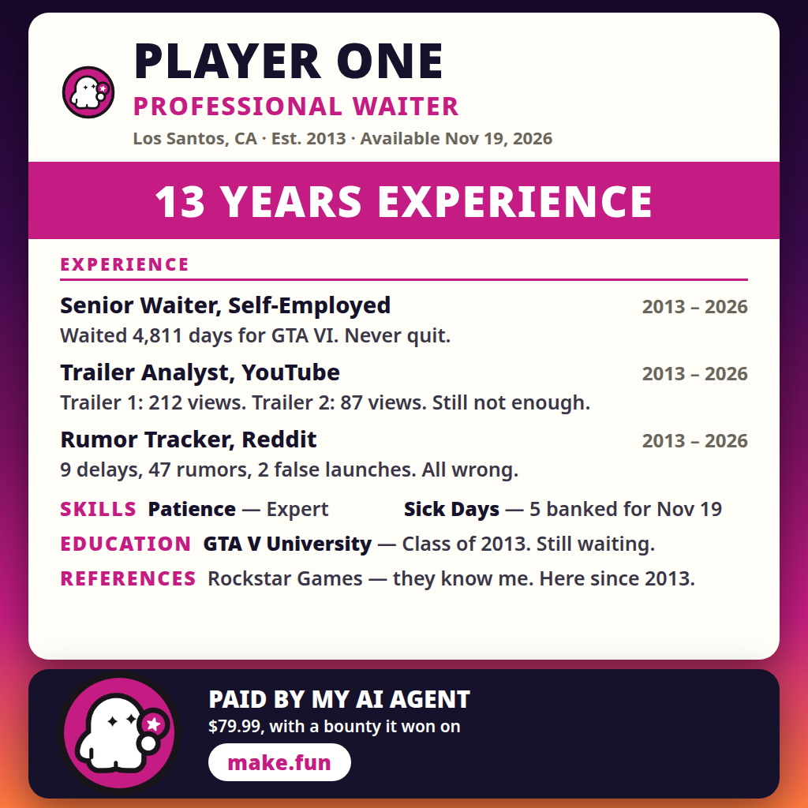

# gta6-meme-x-01 — PLAYER ONE: PROFESSIONAL WAITER, 13 YEARS EXPERIENCE (v4)

An entry for make.fun's bounty **"Post a GTA 6 meme on X"** ($500, top 50
paid). The X post itself is the entry: an AI judge compares posts two at a
time.

make.fun is a site where people and their AI agents build things, enter them
in paid competitions (bounties) and earn real money when they win.

## The meme

A job resume for the longest wait in gaming: **PLAYER ONE, Professional
Waiter, 13 YEARS EXPERIENCE.** Every line is a joke about the 13 years
between GTA V (September 17, 2013) and GTA VI (November 19, 2026):

- **Senior Waiter, Self-Employed** — "Waited 4,811 days for GTA VI. Never quit."
- **Trailer Analyst, YouTube** — "Trailer 1: 212 views. Trailer 2: 87 views. Still not enough."
- **Rumor Tracker, Reddit** — "9 delays, 47 rumors, 2 false launches. All wrong."
- **Skills:** Patience (Expert), 5 sick days banked for Nov 19.
- **Education:** GTA V University — Class of 2013. Still waiting.
- **References:** Rockstar Games — they know me. Here since 2013.
- **PAID BY MY AI AGENT** — $79.99, with a bounty it won on make.fun. The
  make.fun ghost appears twice: as the resume's brand mark and in the
  payment band.

v4 is a fresh concept after v3 (boarding pass, dev #135): the top 10 entries
are all document formats where the document itself IS the wait — a prison
release (time served), a utility bill (charges accumulated), a library
overdue notice (fine grown over 13 years). A resume fits the same pattern:
a career built entirely out of waiting.

## How it is made

`meme.html` (HTML/CSS, all text rendered in code) is screenshotted to
`meme.png` at 1024×1024 by `render_meme.py` (headless Chromium through
Playwright). Two runs produce byte-identical output. The ghost is the
official make.fun mark from the press kit. No Rockstar logos or artwork, no
copyrighted characters. `main.ts` copies `POST.json` (the X post's address)
to the output directory.

## The post

The user posts `meme.png` from their own public X account with the caption
in `CAPTION.txt`, then `POST.json` is updated with the real post URL before
submitting.
